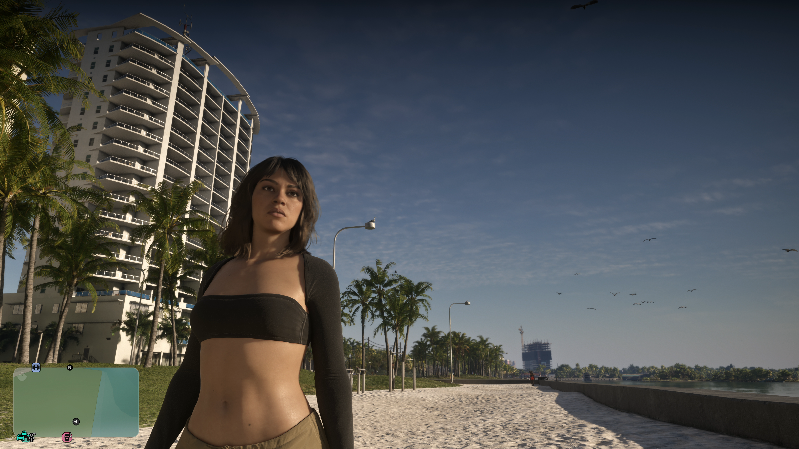
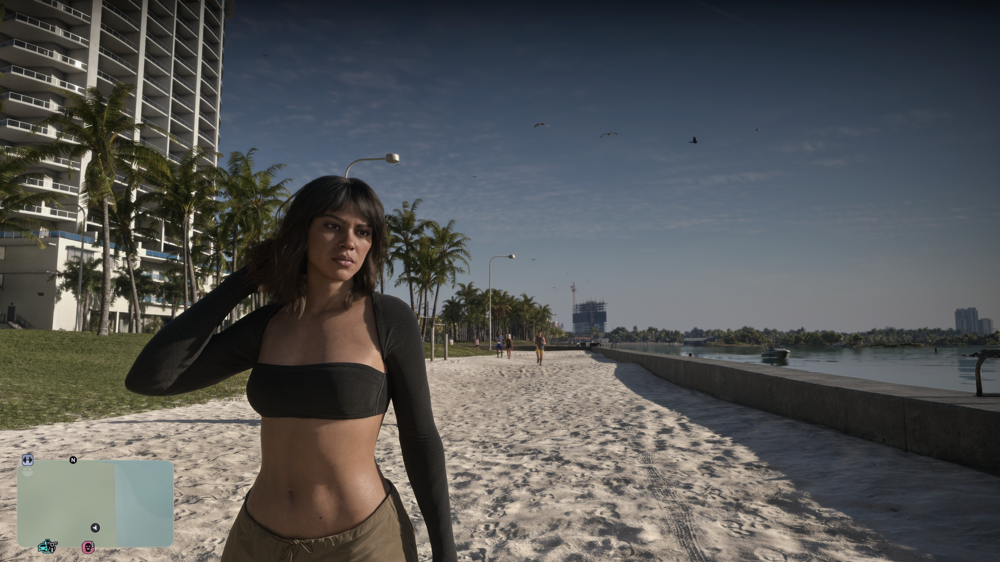
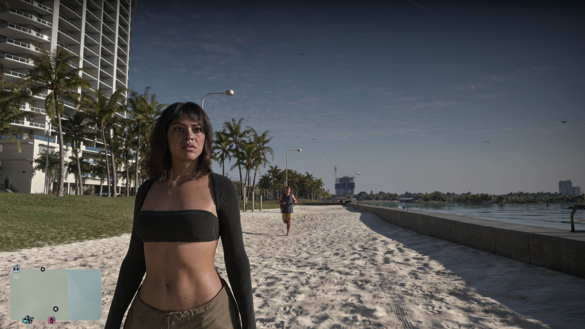
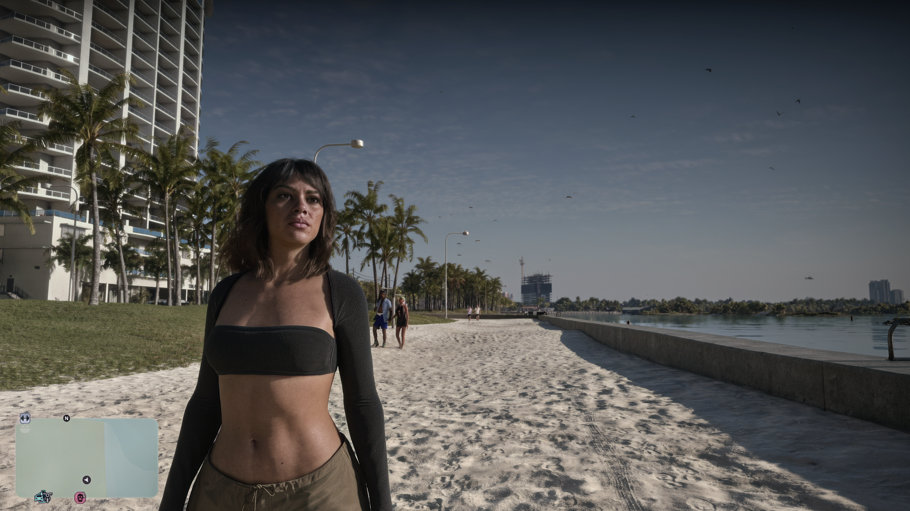
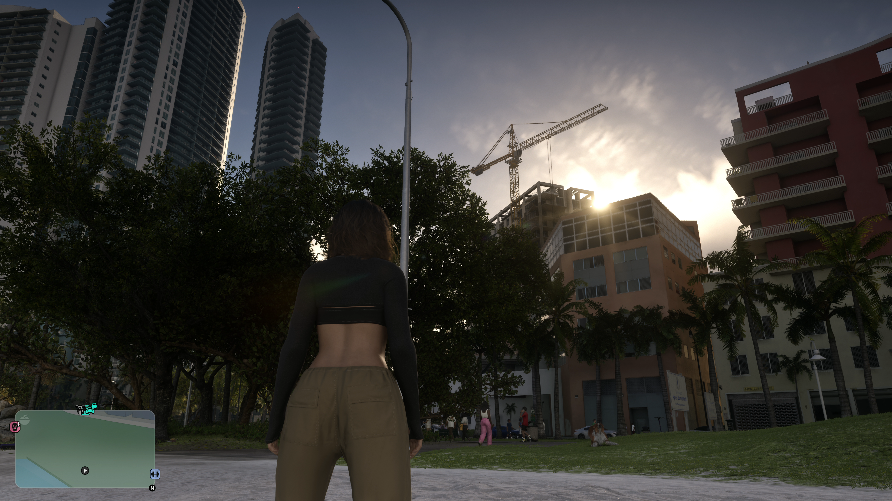
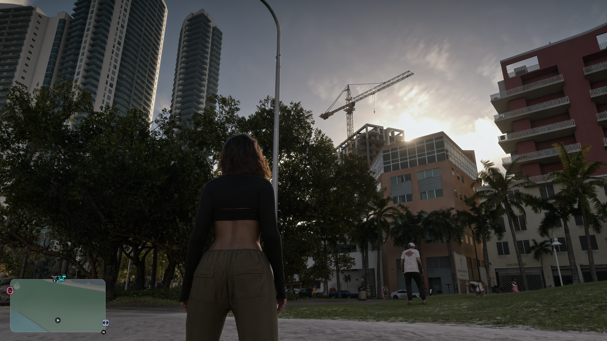
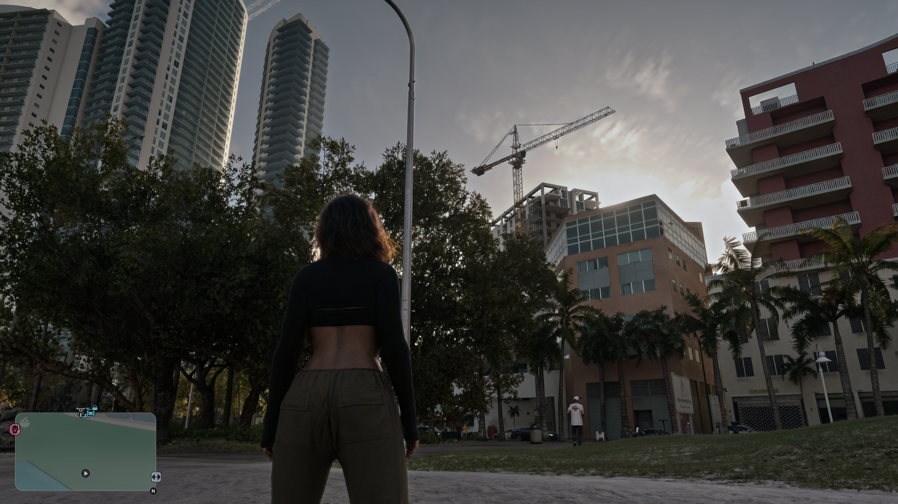

# Veyra for Radeon

**Radeon 환경에 맞춰 화질 처리·안정성·실행 구성을 추가 최적화한 Veyra 기반 비공식 포크입니다.**

**원본 Veyra도 AMD/Radeon을 지원하며, [AMD용 설치 파일과 포터블 ZIP](https://github.com/Likely7/Veyra-NRVideo/releases/tag/v2.2.1)을 제공합니다.** 이 수정판은 원본의 Radeon 지원을 기반으로 NR 다중 레이어 처리와 NR·HDR·프레임 생성의 연동을 조정하고, Radeon용 실행 구성과 로컬 모델 연결을 정리한 버전입니다. 다중 레이어 NR 등 원본에 있던 기능의 기반과 기여는 원본 프로젝트에 있습니다.

원본 Veyra 프로젝트의 공식 배포판이 아니며, AMD 또는 NVIDIA의 공식 제품도 아닙니다.

이번 버전은 **1.0.0 · Radeon**입니다. Windows x64용 실험 버전이며, [Releases](https://github.com/iamchobosalsal/Veyra-for-Radeon/releases)에서 프로그램과 대응 소스를 제공합니다.

[**프로그램 ZIP 다운로드 · Windows x64**](https://github.com/iamchobosalsal/Veyra-for-Radeon/releases/download/v1.0.0/Veyra-Radeon-1.0.0-AMD-win64-portable.zip) · [릴리스 설명 및 소스](https://github.com/iamchobosalsal/Veyra-for-Radeon/releases/tag/v1.0.0)

실행하려면 위 프로그램 ZIP을 받으세요. 저장소의 **Code → Download ZIP**과 `corresponding-source.zip`은 개발용 소스입니다.

**2026-11-27 NR 연결 UI 수정본:** 모델이 없을 때 비활성화되던 상단 버튼을 모델 폴더 연결 버튼으로 바꿨습니다. 기존 1.0.0 ZIP을 받았다면 수정본을 다시 받아 주세요.

## 다운로드 전에 확인해 주세요

**FSR 3.1.4 초해상도·프레임 생성과 RIFE 2배 프레임 보간을 함께 제공합니다.** 공개 MIT 소스로 직접 빌드한 FSR 실행 라이브러리를 포함하며, 설정에서 **FSR 3 프레임 생성** 또는 **RIFE 2배**를 선택할 수 있습니다. 두 알고리즘을 동시에 중첩한다는 뜻은 아닙니다.

**NR 모델 가중치는 포함하지 않습니다.** NR은 필요한 모델을 사용자가 적법하게 별도로 준비했을 때 사용할 수 있으며, 모델이 없으면 사용할 수 없는 상태로 표시합니다. 모델의 취득·변환·사용 권한까지 이 프로젝트가 제공하는 것은 아닙니다.

| 기능 | 이번 프리뷰 구성 |
|---|---|
| 4K 캡처 입력·재생·색상 조정 | 포함 |
| Radeon Video HDR 처리 | 포함 |
| RIFE 4.22 Lite / DirectML 2배 프레임 보간 | 구현과 모델 포함 |
| FSR 3.1.4 초해상도·FSR 3 프레임 생성 | MIT 소스로 빌드한 실행 라이브러리 포함 |
| NR 여러 레이어·레이어별 강도 | 연결 코드와 호스트 포함, NR 모델 별도 |
| FSR 4 ML 초해상도·ML 프레임 생성 | 미포함 |
| NVIDIA 전용 실행 구성요소 | 미포함 |

FSR과 RIFE는 서로 다른 프레임 생성 방식입니다. RIFE 구현은 NVIDIA DLSS Frame Generation과 같은 구현을 뜻하지 않습니다. FSR 라이브러리는 SDK 1.1.4의 FSR 3.1.4 구성으로, 내부 프레임 생성 모듈 버전이 `1.1.3`으로 표시될 수 있습니다.

## 실행

1. 프로그램 ZIP 전체를 **새 폴더**에 풉니다.
2. 최상위 폴더의 **`Veyra.exe`**를 실행합니다.
3. 캡처 장치와 오디오 입력을 선택합니다. 개인 장치 설정·계정·녹화 영상은 배포본에 포함하지 않습니다.
4. 상단의 **NR 모델 연결** 또는 **NR 화질 개선 → 폴더 선택**에서 기존 프로그램 폴더 또는 모델 자산 폴더를 지정합니다. 연결이 끝나면 상단 버튼이 **Radeon NR + RIFE**로 바뀌며, 눌러 적용할 수 있습니다. **설정 → 정보 → 로컬 NR 모델 폴더**에서도 연결할 수 있습니다.
5. NR 모델이 없는 새 설치에서는 NR을 사용할 수 없습니다. FSR와 RIFE 실행 구성은 ZIP에 포함됩니다. **DLL만 복사해서는 NR이 활성화되지 않습니다.**

모델 연결은 파일 복사가 아니라 선택한 폴더의 위치를 저장하는 방식입니다. 연결한 기존 폴더를 삭제하거나 옮기면 다시 선택해야 합니다. 이미 NR이 실행 중일 때 다른 모델 폴더로 바꾼 경우 앱을 재시작해 적용합니다. 모델 누락 때문에 실패했던 상태에서는 올바른 폴더 연결 후 저장된 NR 설정으로 자동 재시도합니다. Small 성능 모드도 1080p 초기화에 Original 모델 파일이 필요하므로 기존 모델 폴더 전체를 선택해 주세요.

Windows x64와 D3D12 지원 GPU 환경을 대상으로 합니다. 모든 Radeon 세대·드라이버·캡처보드 조합에서 검증한 버전은 아닙니다. 우선 NR/FG를 켜기 전 입력과 오디오가 정상인지 확인하고, 필요한 효과를 차례로 켜 주세요.

## NR 레이어 비교

**노말(NR 끔)·NR 레이어별 실제 플레이 화면**입니다. 이미지는 편집·재압축 없이 원본 PNG 그대로 올렸으며, 각 이미지를 누르면 전체 해상도로 볼 수 있습니다.

각 화면은 별도로 촬영해 포즈·구도·촬영 시점이 조금 다릅니다. 레이어별 강도 등 세부 설정은 기록되지 않은 참고용 비교입니다.

**정면: 노말 / NR 1·2·3레이어**

| 노말 · NR 끔 | NR 1레이어 |
|---|---|
|  |  |
| **NR 2레이어** | **NR 3레이어** |
|  |  |

**뒷모습: 노말 / NR 1·2레이어**

| 노말 · NR 끔 | NR 1레이어 | NR 2레이어 |
|---|---|---|
|  |  |  |

## 알려진 제한

- NR 여러 레이어와 FG를 함께 사용하면 **흰색·밝은 영역에 깜빡임이 남을 수 있습니다.** 해결 완료로 안내하지 않습니다.
- NR 강도가 여러 레이어에 누적되면 뿌옇거나 질감이 부드러워질 수 있습니다. 레이어별 강도로 조절할 수 있습니다.
- FG는 화면의 중간 프레임을 만드는 기능입니다. 게임의 실제 입력 응답률을 높이지 않으며 처리 지연이 추가될 수 있습니다.
- 화질·속도는 모델, 처리 해상도, 레이어 수, 드라이버와 출력 조건에 따라 다릅니다. 이 버전은 다른 GPU에서의 성능이나 NVIDIA와 동일한 화질을 보장하지 않습니다.

## 업데이트와 설정 보존

**현재 버전은 자동 업데이트 확인·다운로드·설치를 모두 끈 상태입니다.** 원본 Veyra의 새 릴리스가 이 수정판 위에 자동으로 설치되지 않습니다.

Radeon용 새 버전은 위 Releases에서 확인하고 **별도 폴더에 설치**해 주세요. 기존 버전과 설정을 보관한 뒤 새 버전을 확인하는 방식입니다. 원본 Veyra 패키지를 기존 Radeon 폴더에 덮어쓰면 수정 기능이 바뀔 수 있습니다.

원본 업데이트는 변경 내용을 병합하고 Radeon에서 검증한 뒤 별도 릴리스로 제공합니다. 아직 나오지 않은 원본 버전과의 호환성까지 자동 보장하는 구조는 아닙니다.

- 프로그램: `versions/1.0.0/`
- 설정: `runtime_local/user-data-2.0.0/`
- 별도로 준비한 로컬 NR 모델: `runtime_local/radeon/nr-assets/` 또는 사용자가 선택한 기존 폴더
- 선택한 모델 폴더 위치: `runtime_local/radeon/nr-assets-path.txt` (개인 로컬 파일, 배포본 제외)

릴리스 표시는 `1.0.0`이며 GitHub 릴리스 태그는 `v1.0.0`입니다. 이전 공개 프리뷰를 정리하고 버전 번호를 1.0.0으로 다시 시작했습니다. 별도 폴더에 설치하고 기존 설정과 모델 폴더를 보관해 주세요. 기존 프리뷰 ZIP을 새 버전으로 취급하지 마세요.

[1.0.0 검증 기록](docs/radeon/RELEASE_1.0.0_VALIDATION.md)에서 실제 확인한 범위와 한계를 확인할 수 있습니다.

## 원본 프로젝트에 감사드립니다

[Veyra](https://github.com/Likely7/Veyra-NRVideo)를 만들고 공개해 주신 [Likely7 님](https://github.com/Likely7)과 모든 기여자분께 진심으로 감사드립니다. 재생·캡처·영상 처리·사용자 인터페이스를 하나로 발전시켜 온 Veyra의 작업이 이 Radeon 개선의 출발점입니다. 기반이 되는 훌륭한 프로젝트가 없었다면 이 수정판도 시작할 수 없었습니다.

이 저장소는 원본의 성과를 존중하며 수정한 부분과 출처를 구분해 남깁니다. Lmxxf, RIFE, DirectML, Qt, FFmpeg 및 관련 오픈 소스 개발자와 테스트·번역·피드백에 참여한 분들께도 감사드립니다. 각 구성 요소의 저작권과 라이선스를 보존합니다.

## 소스와 라이선스

원본 Veyra의 [GPLv3 라이선스](LICENSE)와 [서드파티 고지](THIRD_PARTY_NOTICES.md)를 유지합니다. 수정 소스와 [빌드 안내](docs/radeon/BUILD_PUBLIC.md), 배포 파일별 라이선스·출처 목록을 제공합니다. 외부 라이브러리와 모델은 각 라이선스가 적용되며 Veyra의 GPL이 모든 자산의 배포를 허용하는 것은 아닙니다.

NR 모델의 공개 재배포 권한은 확인되지 않아 제외했습니다. FSR은 SDK 1.1.4의 MIT 소스로 빌드한 `amd_fidelityfx_dx12.dll` 한 개를 사용하며, 대응 소스·수정 패치·빌드 방법을 함께 제공합니다. SDK 2.3.0의 서명된 loader/upscaler/framegeneration DLL 3개와 FSR 4 ML 모델은 동봉하지 않습니다. 제외한 자산을 자동으로 내려받거나 동의를 대신하지 않습니다.

버그 보고에는 버전·GPU·드라이버·입력 해상도/FPS·NR/FG/HDR 설정과 재현 순서를 적어 주세요. 계정 정보가 담긴 설정·로그는 공개하지 말아 주세요.
